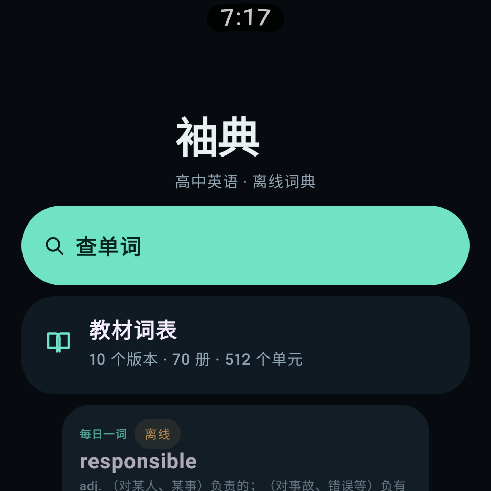
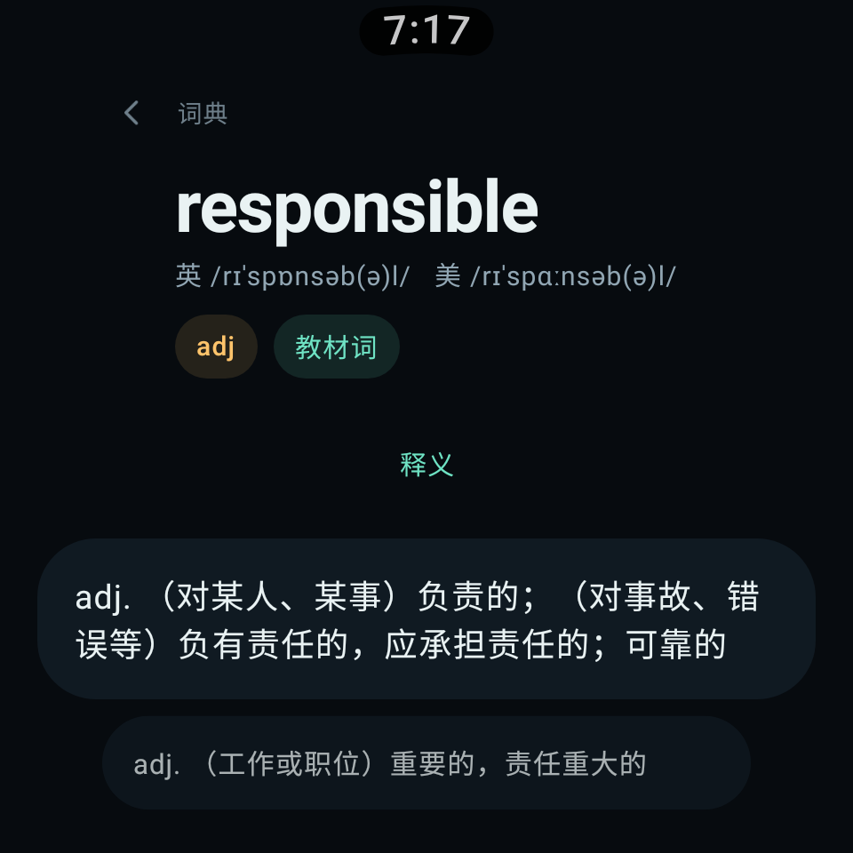
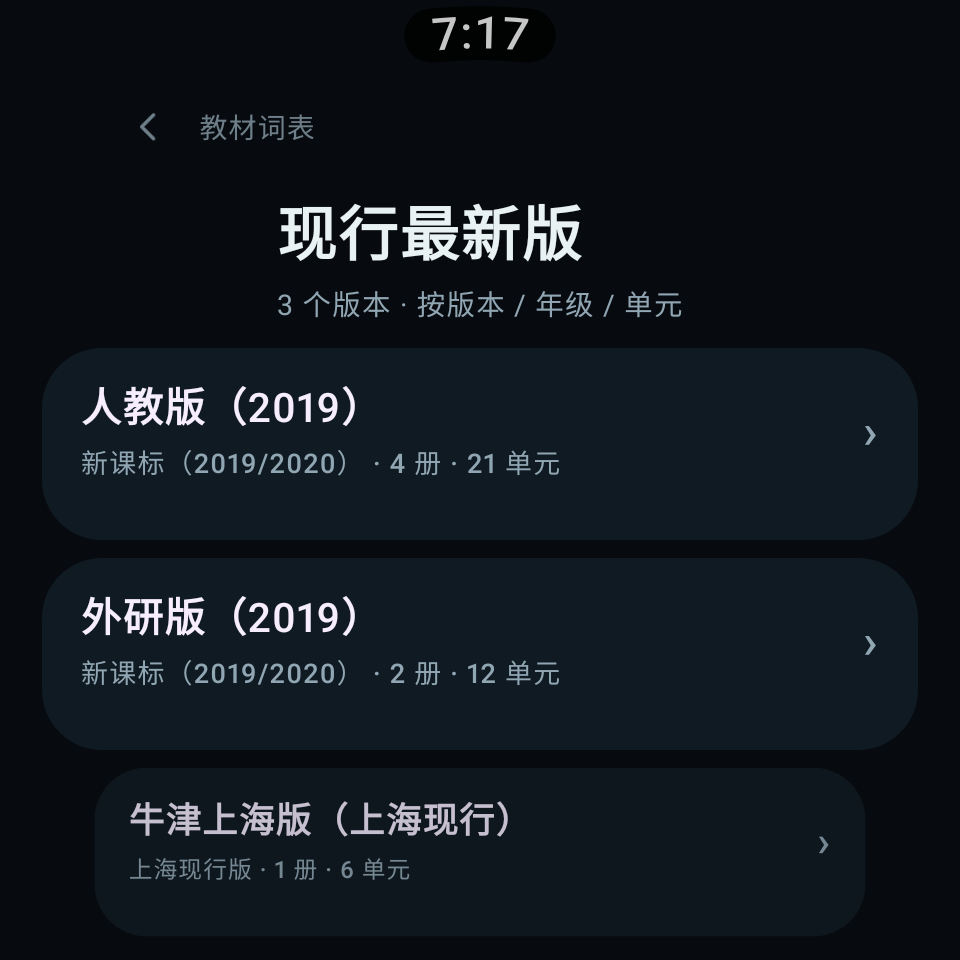

# 袖典 LexiWear

Wear OS 上的高中英语离线词典。用 **Compose for Wear OS** 构建，Material 3 **Expressive** 动效与造型，按「版本 → 年级 → 册次 → 单元」浏览现行教材词表。

<p align="center">
  
  
  
</p>

## 功能

**查单词**
- 释义：按词性分列，多义项完整展示
- 用法：2–3 条双语例句（真实语料，非模板生成）
- 教材搭配：该词在教材词表中出现的固定搭配 / 词组
- 词形变化：复数、过去式、比较级等
- 派生词 / 同根词：按词性分组，点一下继续查该派生词（同样带释义与例句）
- 教材出现位置：该词出现在哪些版本、哪一册、哪个单元

**按教材看词表**
- 10 个现行版本（人教版 2019、外研版 2019、北师大版 2019、译林版 2020、上外版 2020、上教版 2020、冀教版 2019、重大版 2019，以及上海现行牛津上海版、新世纪版）
- 70 册 / 512 单元 / 24,741 条教材词条，单元内顺序与教材词汇表一致
- 入口：版本 → 册次（标注年级）→ 单元 → 词条 → 详情

**手表体验**
- 圆形表盘布局，14dp 横向安全边距
- 旋转表冠 / 滑动滚动，ScalingLazyColumn 边缘缩放
- 系统语音或键盘输入，`ImeAction.Search` 直接检索
- 搜索防抖、分片懒加载（按首字母加载词库，最多缓存 6 片）
- 最近查询记录

## 系统兼容性

| 项 | 说明 |
| --- | --- |
| 最低系统 | **Android 8.0（API 26）**，即 Wear OS 2.x 及以上 |
| 目标系统 | Android 16（API 36） |
| 已验证 | 在 Robolectric API 26 环境离屏渲染四个主界面，中文、音标、圆形安全区均正常（截图见 `docs/screenshots/api26/`） |
| 附加依赖 | 无。`androidx.wear.compose:compose-material3:1.6.2` 自身 minSdk 为 25，降级到 26 无需移除任何功能 |

## 数据规模

| 项 | 数量 |
| --- | --- |
| 词库词条 | 19,177（含派生词补全） |
| 教材词条 | 24,741 |
| 教材版本 | 10 |
| 册次 | 70 |
| 单元 | 512 |
| 安装包 | 约 11 MB（全部离线） |

App **不申请网络权限**，全部数据以 gzip 资源内置。

## 技术栈

- Kotlin 2.2.21 / AGP 8.13.2 / Gradle 8.13 / JDK 17
- `androidx.wear.compose:compose-material3:1.6.2`（含 `MotionScheme.expressive()`）
- Compose 1.9（`androidx.compose.animation` + 自定义 M3E 调色板）
- compileSdk 36 / **minSdk 26（Android 8.0+，Wear OS 2.x 起）** / targetSdk 36
- 数据层：`org.json` + `GZIPInputStream`，无第三方序列化依赖

## 构建

```bash
# 需要 JDK 17+ 与 Android SDK 36
export ANDROID_HOME=/path/to/android-sdk

./gradlew :app:assembleDebug
# 产物：app/build/outputs/apk/debug/app-debug.apk
```

Release 签名读取根目录 `keystore.properties`（**不入库**）：

```properties
storeFile=/absolute/path/lexiwear-release.jks
storePassword=******
keyAlias=lexiwear
keyPassword=******
```

```bash
./gradlew :app:assembleRelease
# 产物：app/build/outputs/apk/release/app-release.apk
```

签名密钥单独备份在私有仓库 `private-keys-backup/LexiWear/`，本仓库不含任何密钥。

## 目录结构

```
app/src/main/java/com/dsdzm/lexiwear/
├── MainActivity.kt
├── data/
│   ├── Models.kt            # 词条 / 教材模型
│   └── LexiRepository.kt    # 资源加载、检索、缓存（接口 + Asset 实现）
└── ui/
    ├── App.kt               # 返回栈与页面路由
    ├── Theme.kt             # M3E 调色板与 MotionScheme
    ├── Common.kt            # SectionCard / Badge / TopBar
    └── screens/             # 首页、搜索、单词、教材、关于
app/src/main/assets/
├── meta.json
├── lex/                     # index + 按首字母分片词库（gzip）
└── tb/                      # 教材索引与 70 册词表（gzip）
tools/build_assets.py        # 数据构建脚本（开发期运行）
app/src/test/                # Robolectric 离屏渲染截图
```

## 数据来源与声明

- 教材单词表：公开整理的现行高中英语教材词表（[word.threeher.cn](https://word.threeher.cn/books/gaozhong/)，CC BY 4.0）
- 音标、释义、双语例句、同根词：有道词典公开接口，**构建时**批量抓取并打包，App 运行时不联网
- 释义为通用词典义项，可能与课本该单元语境义略有出入，学习请以正式教材为准
- 非官方项目，教材名称与词汇表版权归各出版社所有，仅供个人学习与教学研究，不得用于商业发行

## License

代码 MIT；内置词表数据遵循来源许可（CC BY 4.0），教材内容版权归原出版社。
